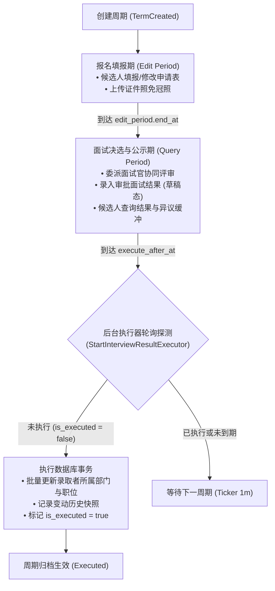
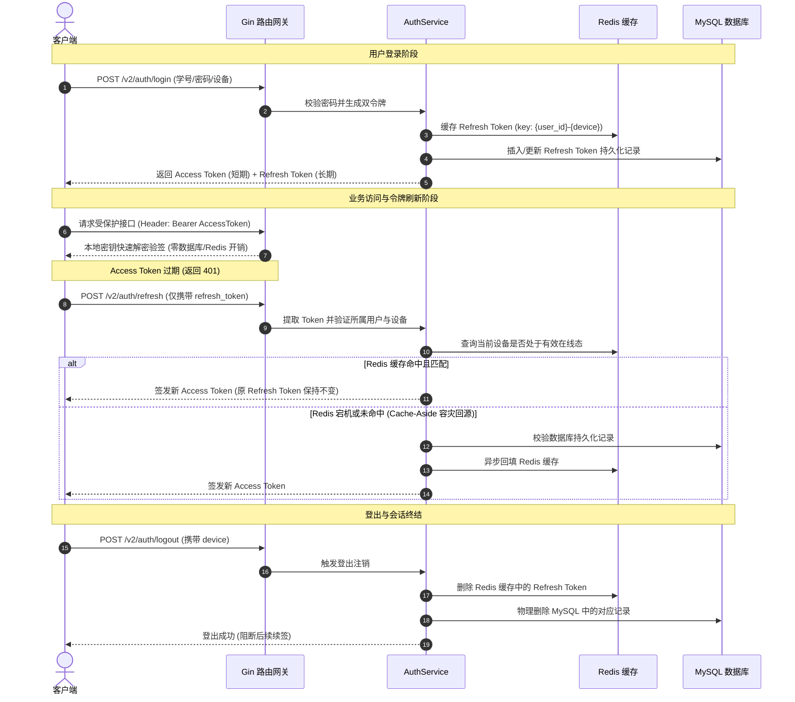

# SUSE OAA Backend

SUSE OAA 后端服务，基于 **Go + Gin + GORM + MySQL + Redis + MinIO** 构建，是四川轻化工大学（SUSE）开放原子开源协会（OpenAtom Association, OAA）自研的组织资产与协同管理中台，面向全生命周期成员管理、分级组织架构、公告分发以及核心的招新 / 换届自动化引擎。

---

## 目录

- [项目背景与业务定位](#项目背景与业务定位)
- [核心业务流转与时序模型](#核心业务流转与时序模型)
  - [1. 招新与换届生命周期状态流转图](#1-招新与换届生命周期状态流转图)
  - [2. Access + Refresh 双 Token 认证与刷新时序图](#2-access--refresh-双-token-认证与刷新时序图)
- [核心架构亮点](#核心架构亮点)
- [统一响应与错误分类规范](#统一响应与错误分类规范)
- [接口一览与详细文档](#接口一览与详细文档)
  - [Auth（认证与令牌）](#auth认证与令牌)
  - [Password（密码服务）](#password密码服务)
  - [User（用户管理与注销冷静期）](#user用户管理与注销冷静期)
  - [Department（部门）](#department部门)
  - [Role（职位）](#role职位)
  - [Announcement（公告）](#announcement公告)
  - [Term（招新 / 换届周期）](#term招新--换届周期)
  - [Application（申请表）](#application申请表)
  - [Interviewer（面试官）](#interviewer面试官)
  - [Interview Result（面试结果）](#interview-result面试结果)
  - [Upload（文件与对象存储）](#upload文件与对象存储)
- [核心机制设计](#核心机制设计)
  - [1. Redis SetNX 原子防刷与安全回滚机制](#1-redis-setnx-原子防刷与安全回滚机制)
  - [2. 账户注销冷静期与级联清理](#2-账户注销冷静期与级联清理)
  - [3. 双后台常驻定时执行器（Daemons）](#3-双后台常驻定时执行器daemons)
  - [4. Refresh Token 双存储与 Cache-Aside](#4-refresh-token-双存储与-cache-aside)
  - [5. 基于 Redis Lua 脚本原子计数的敏感接口 IP 频次限流](#5-基于-redis-lua-脚本原子计数的敏感接口-ip-频次限流)
  - [6. 全链路 TraceID 注入与 slog 结构化日志追溯](#6-全链路-traceid-注入与-slog-结构化日志追溯)
  - [7. 全链路 Context 生命周期穿透](#7-全链路-context-生命周期穿透)
  - [8. 信号监听与全流程优雅停机（Graceful Shutdown）](#8-信号监听与全流程优雅停机graceful-shutdown)
  - [9. MySQL 生产级连接池调优与逻辑外键演进](#9-mysql-生产级连接池调优与逻辑外键演进)
  - [10. MinIO 双端点隔离与纯本地离线预签名](#10-minio-双端点隔离与纯本地离线预签名)
- [权限与组织架构设计](#权限与组织架构设计)
- [已知限制与架构取舍](#已知限制与架构取舍)
- [技术栈](#技术栈)
- [配置文件与部署运行](#配置文件与部署运行)
  - [1. 配置文件结构说明](#1-配置文件结构说明)
  - [2. 构建与运行命令（Makefile）](#2-构建与运行命令makefile)
  - [3. 直接启动](#3-直接启动)
  - [4. CI/CD 流水线与实体机部署](#4-cicd-流水线与实体机部署)

---

## 项目背景与业务定位

### 1. 业务背景与现实痛点
**SUSE OAA 后端中台服务**专为高校开源社团（开放原子开源协会）的数字化治理与全流程协作研发。在以往的高校社团运作中，普遍面临以下痛点：
- **组织协同割裂**：各部门花名册散落在离散 Excel 与社群中，缺乏统一成员认证与精细化权限分级，新老干部换届交接成本高、信息易丢失；
- **招新峰值高并发冲击**：每学年招新季在短时间内面临数千人次的集中填报、免冠照批量上传、多面试官协同打分决选与公示查询。传统离线问卷方式无法保证并发一致性，决策结果容易出现差错或争议；
- **换届与录用手动流转易出错**：录用通过后需手动调整上百名新成员的组织架构（部门、职位变更），耗时耗力且缺乏完整的历史操作快照回溯。

### 2. 核心业务覆盖
系统构建了完备的校园社团数字化协作闭环：
1. **多端认证与精细化组织架构**：支持学号/邮箱安全登录、多设备会话管理、多级组织树流转与基于 Level 的自研 RBAC 动态鉴权；
2. **公告分级下发与精准触达**：支持全员公告、部门定向公告与置顶机制，辅以单条生效与富文本附件直链；
3. **招新与换届全生命周期自动化引擎（核心业务）**：
   - **报名填报期（Edit Period）**：支撑并发填报申请表与免冠证件照上传；
   - **面试决策与异议公示期（Query Period）**：多面试官打分、面试结果动态审批与公开异议倒计时；
   - **到期自动生效流转（Execute Period）**：基于后台常驻 Worker 与冷启动补偿机制，无需人工干预即可在截止后由事务安全、批量地将面试结果回填入正式用户表与组织架构中。

### 3. 架构演进之路（1.0 ➔ 2.0）
本项目经历了一次至关重要的架构升级与全链路独立重构：
- **1.0 原型期（双人探索）**：早期版本由两位核心成员共同搭建，主要验证业务链路可行性。受限于早期经验，业务逻辑与数据访问层深度杂糅，且强依赖外部商业云服务器与商用对象存储，扩展性弱且维护成本高昂。
- **2.0 独立重构期（独立主导）**：随着业务复杂度剧增，为支撑复杂状态机与高并发诉求，由核心开发者独立主导了 2.0 版本的全链路重构：
  - **整洁分层架构**：规范推行 `Handler ➔ Service ➔ Repository` 三层解耦标准，隔离数据访问与业务逻辑，提升系统的可维护性与可测试性；
  - **基础设施自主可控与降本增效**：团队将核心系统迁移至实体服务器，并自建私有化 **MinIO 分布式对象存储**集群替代云 OSS，通过内网闭环上传与纯本地离线预签名直链，消除外部带宽成本并大幅降低读写延迟；
  - **企业级健壮性加固**：落地全链路 `TraceID` 可观测性、基于 Redis Lua 脚本的高性能无锁 IP 限流、软删除联合索引防失效破局、优雅停机与异步执行器冷启动补偿等工程实践。

---

## 核心业务流转与时序模型

### 1. 招新与换届生命周期状态流转图



### 2. Access + Refresh 双 Token 认证与刷新时序图



---

## 核心架构亮点

- **账号与令牌安全（Access + Refresh 双 Token 机制）**：
  - 采用无状态短周期 Access Token + 有状态长周期 Refresh Token 双令牌模型，兼顾高效本地验签与精准会话控制。
  - Refresh Token 采用双存储 Cache-Aside 架构（Redis 优先缓存 + MySQL 持久化底座），支持零断连容灾回源与同端单设备互踢。
  - 登出或账号注销时，主动清理 Redis 与 MySQL 中的 Refresh Token 凭据，阻断后续会话续签；存量 Access Token 依靠短暂生命周期自然失效。
- **敏感接口 IP 频次限流（Rate Limiting）**：
  - 基于 Redis Lua 脚本原子执行 `INCR` 与 `EXPIRE` 实现无锁限流中间件（单次网络 RTT 闭环），对密码登录（10 次/分）与邮箱发信（5 次/分）实施精准防刷与防爆破，超频直接返回 `429 Too Many Requests`，避免流量穿透到底层高耗算力模块（Bcrypt 校验）与第三方 SMTP 服务。
  - 网关显式配置 `SetTrustedProxies` 受信任反向代理列表，阻断伪造 `X-Forwarded-For` 绕过限流的安全漏洞。
- **密码学级安全验证码与原子防刷（SetNX 冷却标记，失败安全回滚）**：
  - 基于 Go 标准库 `crypto/rand` 与 `math/big` 动态生成密码学安全的纯数字验证码，防范伪随机数种子被时间戳预测的隐患。
  - 基于 Redis `SetNX` 单指令写入请求独占的随机 Token 作为前置原子防刷冷却标记，解决传统“先查后发”在高延迟 SMTP 网络 I/O 下的并发穿透隐患。
  - 具备发信异常补偿回滚机制：释放冷却标记时通过 Redis Lua 脚本原子校验 Token（CAS 比对并删除），避免因网络抖动超时误删他人后置冷却标记。
- **密码重置与安全敏感链路加固**：
  - 重置密码接口挂载独立限流中间件（5 次/分），防止枚举。
  - 验证码比对引入 Go 标准库 `crypto/subtle.ConstantTimeCompare` 恒定时间算法，阻断计时侧信道攻击；且单次验证码连续输错达到 5 次立即在 Redis 中原子销毁作废，有效防范 6 位纯数字暴力枚举。
- **完善的注销冷静期流程**：
  - 用户自主注销进入 24 小时冷静期（常量 `UserDeletionGracePeriod = 24h`），期间账号权益完全正常。
  - 支持随时通过 `POST /v2/user/delete` 查询倒计时，支持通过安全邮箱验证码（`scene = "cancel_delete"`）一键撤销冷静期。
  - 结合后台常驻执行器每分钟轮询，倒计时结束自动软删除并级联清理所有关联凭证。
- **全链路可观测性与 TraceID 日志**：
  - 全局中间件自动为每个 HTTP 请求注入唯一 `X-Trace-ID` 响应头与 Request Context，对客户端传入的 TraceID 实施严格长度与字符集白名单校验，防范 CRLF 日志注入与响应头拆分攻击。
  - 基于 Go 1.21+ 标准库 `log/slog` 构建结构化日志，全链路日志自动附带 TraceID，支持生产环境单次请求的精准端到端问题复现。
- **生产级底层健壮性与优雅停机**：
  - **优雅停机（Graceful Shutdown）**：捕获系统中断信号（`SIGINT`/`SIGTERM`），自顶向下先通过 `srv.Shutdown` 缓冲处理存量请求，再级联终止后台常驻协程并等待退出，最后安全关闭 MySQL 与 Redis 连接池，避免事务半写入与连接泄露。
  - **MySQL 连接池全套调优**：最大打开连接（100）、最大空闲连接（25）、单连接存活寿命（60m）、空闲回收时间（10m），配合 Fail-Fast 启动保护与智能默认值兜底。
  - **逻辑外键演进**：全表采用逻辑外键设计，由业务层事务保证引用完整性，避免高并发下的外键间隙锁死锁与 DDL 锁表隐患。
  - **全链路 Context 穿透**：所有 HTTP 请求上下文深度贯穿 GORM 事务、Redis 缓存与 MinIO 传输，客户端断开或超时即刻阻断底层 I/O，减少无用资源悬挂。
  - **MinIO 双端点隔离**：内网走局域网无公网开销；外网签名纯本地哈希离线计算，消除网络探测延迟与 502/Region 不匹配错误。
- **自动化 CI/CD 与实体机持续交付**：
  - 基于 GitHub Actions 搭建全自动 CI/CD 质量门禁（PR/Push 自动触发 `go vet`、竞态单元测试 `-race` 与编译检查），保障主干分支代码质量。
  - 支持 Git Tag 一键自动化发版打包（Linux amd64 静态编译、剥离调试符号瘦身并自动生成 SHA256 校验和上传 GitHub Releases）。
  - 支持基于 GitHub Self-Hosted Runner 的实体机自动化无感热部署（内网长连接反向拉取任务，零公网 IP/端口暴露风险）。

---

## 统一响应与错误分类规范

所有 HTTP 接口的响应格式统一遵循以下结构，HTTP 状态码与业务 `code` 严格对齐，形成标准的 **5+1 语义化响应体系**：

### 1. 响应结构定义

```json
{
  "code": 200,
  "message": "success",
  "data": null // 数据载荷（对象、数组、字符串或 null）
}
```

### 2. 状态码与语义分类体系

| HTTP 状态码 | 业务方法 | 适用场景 | 前端处理建议 |
| :--- | :--- | :--- | :--- |
| **`200 OK`** | `response.Success(c, data)` | 业务正常执行完毕 | 正常消费 `data` 并渲染页面 |
| **`400 Bad Request`** | `response.BadRequest(c, msg)`<br>`response.BadRequestWithData(c, msg, data)` | 业务参数校验失败、账号密码错误、不在填报时间范围内、业务规则受限 | 页面提示错误文案；若携带 `data`（如批量部分失败、冷静期时间）则提取展示 |
| **`401 Unauthorized`** | `response.Unauthorized(c, msg)` | 请求头未携带 Token、Bearer 格式错误、Token 过期或被篡改 | **清除本地缓存 Token，跳转至登录页面** |
| **`403 Forbidden`** | `response.Forbidden(c, msg)` | 身份有效但权限不足（如越权修改高职级数据、跨部门非法操作） | 弹窗或浮层提示“无权操作此资源” |
| **`429 Too Many Requests`** | `response.TooManyRequests(c)` | 触发 IP 频次限制（登录/发信超频） | 按钮倒计时置灰并提示“请求过于频繁，请稍后再试” |
| **`500 Internal Error`** | `response.ServerError(c, action, err)` | 数据库故障、网络宕机、第三方存储异常等未预期服务器崩溃 | 统一展示脱敏友好提示：`"服务开小差了，请稍后再试"` |

### 3. 底层错误脱敏与转译策略

1. **500 异常强脱敏与日志追溯**：
   `response.ServerError(c, action, err)` 绝不向前端暴露底层 SQL 语句、表名、代码堆栈或 MinIO 错误，统一返回安全文案 `"服务开小差了，请稍后再试"`；同时在服务端自动提取上下文 TraceID 并通过 `logger.ErrorContext` 输出完整堆栈与错误原因，便于运维定位。
2. **MySQL 1062 唯一约束冲突转译**：
   在 Repository 层针对数据插入与更新捕获 `mysqlErr.Number == 1062`，自动转译为业务友好提示（如 `"学号、邮箱或用户名已被占用"`、`"部门名称已存在"`、`"职位名称已存在"`、`"创建失败，该年份类型的数据已存在"`），作为 400 业务错误返回，避免向客户端直接暴露 500 堆栈。
3. **`gorm.ErrRecordNotFound` 转译**：
   在 Service 层捕获 GORM 空记录异常并转译为 `"账号不存在"`、`"用户不存在"` 等具体业务语义，避免向客户端输出原生的 `record not found`。

---

## 接口一览与详细文档

所有业务接口前缀统一为 `/v2`。

除注册、登录、刷新 Token、发送验证码、验证码重置密码等公开接口外，**其余接口均需在 HTTP Header 中携带 Bearer Token**：

```http
Authorization: Bearer <token>
```

---

### Auth（认证与令牌）

| 方法 | 路径 | 鉴权 | 说明 | 频控限制 | 请求参数 |
|---|---|---|---|---|---|
| POST | `/v2/auth/register` | 公开 | 用户注册 | 无 | JSON：`student_id`、`username`、`name`、`email`、`password` |
| POST | `/v2/auth/login` | 公开 | 用户登录 | **10次/分 (IP)** | JSON：`account`（支持学号/用户名/邮箱）、`password`、`device`（设备标识） |
| POST | `/v2/auth/refresh` | 公开 | 刷新令牌 | 无 | JSON：`refresh_token` |
| POST | `/v2/auth/send` | 公开 | 发送邮箱验证码（SetNX 随机 Token 冷却防刷） | **5次/分 (IP)** | JSON：`account`、`scene`（场景值） |
| POST | `/v2/auth/logout` | 登录 | 当前设备登出（清理 Refresh Token） | 无 | JSON：`device` |

#### `POST /v2/auth/send` 支持的业务场景（`scene`）：
1. `reset_password`：找回/重置密码。
2. `delete_user`：本人自主注销账号。若当前账号已经处于注销冷静期内，服务端会直接拦截返回 `400 "账号已处于注销冷静期"`。
3. `cancel_delete`：本人取消注销冷静期。若当前账号未处于注销冷静期，服务端会直接拦截返回 `400 "当前账号未处于注销冷静期"`。

---

### Password（密码服务）

| 方法 | 路径 | 鉴权 | 说明 | 频控限制 | 请求参数 |
|---|---|---|---|---|---|
| POST | `/v2/auth/password/update` | 登录 | 修改登录密码 | 无 | JSON：`old_password`、`new_password` |
| POST | `/v2/auth/password/reset` | 公开 | 邮箱验证码重置密码（恒定时间校验，连续输错 5 次熔断作废） | **5次/分 (IP)** | JSON：`account`、`code`、`password` |

---

### User（用户管理与注销冷静期）

| 方法 | 路径 | 鉴权 | 说明 | 请求参数 |
|---|---|---|---|---|
| GET | `/v2/user/me` | 登录 | 获取当前登录用户资料 | 无 |
| GET | `/v2/user/list` | 登录 | 分页筛选用户列表 | Query：见下方说明 |
| POST | `/v2/user/me/update` | 登录 | 修改当前用户基础资料 | JSON：`username`、`email`、`avatar`（资源路径） |
| POST | `/v2/user/batch` | 登录 | 批量调整成员部门与职位 | JSON 数组：每项包含 `user_id`、`department_id`、`role_id` |
| POST | `/v2/user/delete` | 登录 | 删除用户 / 注销自己 / 查询冷静期 | JSON：`user_id`（可选）、`code`（可选，二者严格互斥） |
| POST | `/v2/user/delete/cancel` | 登录 | 取消注销冷静期（本人） | JSON：`code`（`cancel_delete` 验证码） |

#### 1. `GET /v2/user/me` 返回数据示例：
```json
{
  "code": 200,
  "message": "success",
  "data": {
    "user_id": 1,
    "student_id": "20240101",
    "username": "zhangsan",
    "name": "张三",
    "avatar": {
      "uri": "avatar/uuid.png",
      "url": "https://obj.suseoaa.com/oaa-img/avatar/uuid.png?X-Amz-..."
    },
    "email": "zhangsan@example.com",
    "department": "项目实践部",
    "role": "干事",
    "role_level": 20,
    "scheduled_delete_at": "2026-10-01T23:11:03+08:00" // 仅当账号处于冷静期时存在
  }
}
```

#### 2. `GET /v2/user/list` 查询参数：
- `keyword`：关键字模糊匹配（姓名、用户名、学号）。
- `department` / `department_id`：部门名称或部门 ID。
- `role` / `role_id`：职位名称或职位 ID。
- `page`：当前页码（默认 `1`）。
- `page_size`：每页条数（默认 `20`，单页上限 `100`）。
- `is_all`：传 `true` 时包含已停用成员，默认为 `false`。
- **返回结构**：`data` 数组包含 `UserInfo` 列表，外层包含当前筛选条件下的 `total` 总条数。

#### 3. `POST /v2/user/delete` 权限、互斥与调用规则：
> [!IMPORTANT]
> **字段互斥规则**：`user_id` 和 `code` 只能其中一个有值，或者两者皆为空。**严禁同时传递**，否则直接返回 400（`"参数错误：user_id 与 code 不能同时传递"`）。

- **场景 A：管理员强制删除他人**
  - **传参**：`{"user_id": 目标ID}`（`code` 留空）。
  - **权限**：副会长及以上（`level >= 80`）且自身职位等级必须严格高于目标用户。
  - **效果**：无须验证码，不进入冷静期，立即软删除目标用户，并级联清理该用户全设备 Token，返回 200。
- **场景 B：本人首次发起注销申请**
  - **传参**：`{"code": "123456"}`（`user_id` 留空，后端自动从 JWT 获取）。
  - **前置**：先调用 `POST /v2/auth/send` 传入 `scene = "delete_user"` 获取邮箱验证码。
  - **效果**：验证码校验通过后进入 **24 小时注销冷静期**（`scheduled_delete_at = NOW() + 24h`），返回 200。冷静期内账号权益、登录鉴权不受任何影响。
- **场景 C：查询本人注销冷静期状态**
  - **传参**：`{}` 或 `{"code": ""}`（两者皆为空）。
  - **效果**：
    - 若账号**处于冷静期内**：返回 `400`，`message: "账号处于冷静期"`，`data` 返回到期彻底注销的北京时间字符串（格式为 `YYYY-MM-DD HH:mm:ss`，例如 `"2026-09-30 16:00:00"`）。
    - 若账号**未处于冷静期**：返回 `400`，`message: "当前账号未处于注销冷静期"`。
    - 若账号**冷静期已满**：触发彻底软删除与级联清理，返回 200。

#### 4. `POST /v2/user/delete/cancel` 取消注销冷静期：
- **严格本人操作**：从 JWT 鉴权解析当前登录用户 ID。
- **传参**：`{"code": "654321"}`（先通过 `POST /v2/auth/send` 发送 `scene = "cancel_delete"` 的验证码）。
- **效果**：验证码校验成功后立即清除验证码，并将数据库中的 `scheduled_delete_at` 恢复重置为 `NULL`，返回 200 成功。

---

### Department（部门）

| 方法 | 路径 | 鉴权 | 说明 | 请求参数 |
|---|---|---|---|---|
| GET | `/v2/department/list` | 登录 | 获取全部部门列表 | 无 |
| POST | `/v2/department/create` | 登录 | 创建部门（需 `level >= 80`） | JSON：`name`、`type`（`部门` / `协会`） |
| POST | `/v2/department/update` | 登录 | 更新部门（需 `level >= 80`） | JSON：`department_id`、`name`、`type`、`is_active` |

---

### Role（职位）

| 方法 | 路径 | 鉴权 | 说明 | 请求参数 |
|---|---|---|---|---|
| GET | `/v2/role/list` | 登录 | 获取全部职位列表 | 无 |
| POST | `/v2/role/create` | 登录 | 创建职位（需 `level >= 80`） | JSON：`name`、`level`（数字）、`type`（`部门` / `协会`） |
| POST | `/v2/role/update` | 登录 | 更新职位（需 `level >= 80`） | JSON：`role_id`、`name`、`level`、`type`、`is_active` |

---

### Announcement（公告）

| 方法 | 路径 | 鉴权 | 说明 | 请求参数 |
|---|---|---|---|---|
| POST | `/v2/announcement/create` | 登录 | 创建公告草稿 | JSON：`department_id`、`title`、`content` |
| POST | `/v2/announcement/update` | 登录 | 编辑公告内容 | JSON：`announcement_id`、`title`、`content` |
| POST | `/v2/announcement/push` | 登录 | 推送发布公告（生效） | JSON：`announcement_id` |
| GET | `/v2/announcement/list` | 登录 | 获取公告列表 | Query：`status`（`active` / `history` / `draft` 可选）、`content`（布尔值，是否返回正文内容，默认 `false`） |
| GET | `/v2/announcement/get` | 登录 | 获取指定公告详情 | Query：`announcement_id`（必填） |
| POST | `/v2/announcement/delete` | 登录 | 删除公告 | JSON：`announcement_id` |

> [!NOTE]
> - 公告正文（Markdown 或 HTML）中支持直接嵌入内部对象路径（例如 `oss://oaa-img/announcement/xxx.png` 或 `oss://oaa-file/...`）。后端在返回详情和包含正文的列表时，会自动正则提取并批量转换为带有效期的公网预签名访问链接。
> - 同一部门在同一时刻只允许存在一条生效公告（`active`）；推送新公告时，该部门原生效公告会自动归档为历史公告（`history`）。

---

### Term（招新 / 换届周期）

| 方法 | 路径 | 鉴权 | 说明 | 请求参数 |
|---|---|---|---|---|
| POST | `/v2/term/create` | 登录 | 创建周期（`level >= 80`） | JSON：`year`、`type`（`招新`/`换届`）、`title`、`edit_period`、`query_period` |
| POST | `/v2/term/update` | 登录 | 更新周期（`level >= 80`） | JSON：`term_id`、`title`、`edit_period`、`query_period` |
| GET | `/v2/term/list` | 登录 | 获取周期列表（全员开放） | Query：`year`、`type` 可选 |
| POST | `/v2/term/delete` | 登录 | 删除周期（`level >= 80`） | JSON：`term_id` |

- **时间格式**：时间区间中的日期格式为 `YYYY-MM-DD`（如 `2026-09-01`），后端自动解析为北京时间（开始时间为当天 `00:00:00`，结束时间自动延展至当天 `23:59:59`）。
- **执行时间计算**：创建或更新周期时，系统自动将 `execute_after_at` 设置为 `query_period.end_at + 1分钟`。
- **级联删除约束**：已执行完成的周期（`is_executed = true`）禁止删除；删除未执行的周期时，会在事务中级联软删除关联的全部申请表、面试官与面试结果。

---

### Application（申请表）

| 方法 | 路径 | 鉴权 | 说明 | 请求参数 |
|---|---|---|---|---|
| POST | `/v2/application/create` | 登录 | 提交周期申请表 | JSON：见下方字段说明 |
| POST | `/v2/application/update` | 登录 | 更新本人最新的申请表 | JSON：见下方字段说明（无需传 `term_id`） |
| GET | `/v2/application/me` | 登录 | 查询当前登录用户的最新申请表 | 无 |
| GET | `/v2/application/department` | 登录 | 根据意向职位联动查询可选部门 | Query：`role_id`（可选） |
| GET | `/v2/application/role` | 登录 | 根据意向部门联动查询可选职位 | Query：`department_id`（可选） |
| GET | `/v2/application/list` | 登录 | 查看指定周期的申请表列表 | Query：`term_id`（必填）、`department_id`（可选） |
| POST | `/v2/application/delete` | 登录 | 删除申请表 | JSON：`application_id` |

#### 申请表字段说明：
```json
{
  "term_id": 1,
  "college": "计算机科学与工程学院",
  "major_class": "计科241",
  "gender": "男",
  "avatar": "application/uuid.png", // 选填，上传时 scene=application；没有时传空或不传
  "phone": "13800000000",
  "qq": "123456789",
  "political_status": "共青团员",
  "birth_date": "2005-09",
  "first_choice": {
    "department_id": 1,
    "role_id": 6
  },
  "second_choice": {
    "department_id": 2,
    "role_id": 6
  },
  "allow_adjust": true,
  "resume": "个人经历阐述",
  "reason": "申请理由阐述"
}
```

- 只能在周期的 `edit_period`（报名编辑期）内创建或修改申请。
- 第一志愿与第二志愿允许选择同一部门/职位；所选部门与职位类型必须相符。
- 申请表中的个人姓名、学号由后端从当前登录用户强制绑定回填，防止前端伪造。

---

### Interviewer（面试官）

| 方法 | 路径 | 鉴权 | 说明 | 请求参数 |
|---|---|---|---|---|
| POST | `/v2/interviewer/create` | 登录 | 批量委派面试官（`level >= 80`） | JSON：`term_id`、`interviewers`（数组：`user_id`、`remark`） |
| POST | `/v2/interviewer/update` | 登录 | 更新面试官备注（`level >= 80`） | JSON：`interviewer_id`、`remark` |
| GET | `/v2/interviewer/list` | 登录 | 获取面试官列表 | Query：`term_id` 可选 |
| POST | `/v2/interviewer/delete` | 登录 | 移除面试官（`level >= 80`） | JSON：`interviewer_id` |

- 同一周期内禁止重复指派同一用户作为面试官。
- 添加面试官时，系统自动关联并回填该成员在协会内的所属部门。已执行完成的周期禁止更改面试官。

---

### Interview Result（面试结果）

| 方法 | 路径 | 鉴权 | 说明 | 请求参数 |
|---|---|---|---|---|
| POST | `/v2/interviewer/result/create` | 登录 | 录入面试结果（面试官/管理员） | JSON：`application_id`、`decision`、`result_department_id`、`result_role_id`、`remark` |
| POST | `/v2/interviewer/result/update` | 登录 | 更新面试结果（面试官/管理员） | JSON：`application_id`、`decision`、`result_department_id`、`result_role_id`、`remark` |
| GET | `/v2/interviewer/result/list` | 登录 | 查询面试结果列表 | Query：`term_id` 可选 |
| GET | `/v2/interviewer/result/decision` | 登录 | 获取面试决策枚举列表 | 无 |

#### 决策枚举（`decision`）校验规则：
- `录取第一志愿`：最终部门与职位必须与申请表的第一志愿完全一致。
- `录取第二志愿`：最终部门与职位必须与申请表的第二志愿完全一致。
- `已调剂`：申请表必须勾选 `allow_adjust = true`，且最终部门与职位类型必须匹配。
- `未通过`：`result_department_id` 与 `result_role_id` 必须传 `0`。
- 面试结果在查询期内为草稿状态，到达 `execute_after_at` 后由后台定时常驻任务批量正式生效。

---

### Upload（文件与对象存储）

| 方法 | 路径 | 鉴权 | 说明 | 请求参数 |
|---|---|---|---|---|
| POST | `/v2/upload/image` | 登录 | 上传图片文件 | `multipart/form-data`：`file`（文件）、`scene`（场景名） |
| POST | `/v2/upload/file` | 登录 | 上传通用文件 | `multipart/form-data`：`file`（文件）、`scene`（场景名） |

- **常用场景 `scene`**：`avatar`（用户头像）、`application`（申请表免冠照）、`announcement`（公告插图/附件）。
- **图片类型白名单**：`.jpg`、`.jpeg`、`.png`、`.webp`、`.gif`、`.avif`（扩展名自动转小写兼容，支持移动端相册大写 `.JPG`/`.PNG` 等原图直传）。
- **上传成功返回**：
  ```json
  {
    "code": 200,
    "message": "success",
    "data": {
      "uri": "avatar/123e4567-e89b-12d3-a456-426614174000.png",
      "url": "https://obj.suseoaa.com/oaa-img/avatar/123e4567-e89b-12d3-a456-426614174000.png?X-Amz-..."
    }
  }
  ```

---

## 核心机制设计

### 1. Redis SetNX 原子防刷与安全回滚机制

传统邮箱验证码防刷常采用“先查 Redis 是否有冷却 Key，若没有则调 SMTP 发信，发完再写 Redis”，在 SMTP 发信通常需要 500ms ~ 2s 网络 I/O 的情况下，极易被并发请求穿透刷信。

本系统将其重构为 **`SetNX` 前置原子防刷冷却标记 + Lua CAS 安全回滚**：

- **独占 Token 占位**：调用 `SetCooldownNX` 时，生成当前请求独占的高熵随机 Token（UUID）作为 Value 进行原子占位，防范并发穿透；
- **Lua CAS 安全释放**：若验证码写入或 SMTP 发信失败，通过 Redis Lua 脚本原子比对当前 Key 的 Value 是否与当前 Token 一致，仅在匹配时才执行 `DEL`，避免因外部网络延迟导致标记过期后误删他人后置冷却标记。

```text
客户端请求 -> SetCooldownNX (rdb.SetNX 写入专属随机 Token 前置占位)
  ├── 写入失败 (冷却未到期) ──> 立即拦截，返回 400 "间隔太短" (零耗时，不调用邮件服务)
  └── 写入成功 (占位成功)   ──> 生成验证码写入 Redis ──> 调用 SMTP 发信
                                ├── 发信成功 ──> 返回 200 success
                                └── 发信失败 ──> 触发安全补偿回滚 (Redis Lua 校验 Token 一致才 DEL 冷却 Key) ──> 允许即时重试
```

### 2. 账户注销冷静期与级联清理

为了防止用户误操作注销，同时防范账号注销后的越权与幽灵会话隐患，系统设计了闭环的注销机制：

1. **进入冷静期**：本人自主注销必须提供 `scene = "delete_user"` 的邮箱验证码，验证通过后进入 24 小时冷静期（`scheduled_delete_at = NOW() + 24h`），在此期间用户保留所有访问权限。
2. **状态感知与查询**：冷静期内，`GET /v2/user/me` 会返回 `scheduled_delete_at`；调用 `POST /v2/user/delete`（不带参数或传空 `{}`）可直接获取以北京时间格式化的到期截止时间（`YYYY-MM-DD HH:mm:ss`）。
3. **取消注销冷静期**：用户若中途改变主意，通过 `POST /v2/auth/send` 获取 `scene = "cancel_delete"` 的验证码，调用 `POST /v2/user/delete/cancel` 即可将 `scheduled_delete_at` 恢复为 `NULL`。
4. **级联清理与软删除**：当账号冷静期结束（或被高级别管理员强制删除）触发正式删除时，系统将：
   - 软删除 `users` 记录；
   - 级联清除 MySQL `refresh_tokens` 表中该用户在全设备的所有 Refresh Token；
   - 级联删除 Redis 中该用户所有设备的 Refresh Token 缓存（`{user_id}-{device}`）、所有业务场景验证码（`{user_id}-{scene}VerificationCode`，涵盖重置密码、注销及取消注销）以及防刷冷却标记（`{user_id}-CoolDown`）。

### 3. 双后台常驻定时执行器（Daemons）

系统在 `cmd/main.go` 启动时并行拉起两个轻量级后台常驻协程（基于 `time.NewTicker`，每分钟调度一次，受 `context.Context` 生命周期控制）：

1. **`StartUserDeletionExecutor`（到期用户注销执行器）**：
   - 轮询扫描数据库：`scheduled_delete_at IS NOT NULL AND scheduled_delete_at <= NOW()`；
   - 批量触发级联软删除与会话清理，无需等待用户下次主动访问。
2. **`StartInterviewResultExecutor`（周期面试结果执行器）**：
   - 轮询扫描到期招新/换届周期：`is_executed = false AND execute_after_at <= NOW()`；
   - 在独立数据库事务中，自动将候选人面试决策落地，批量变更录用者的部门与职位，记录变动轨迹，并将周期标记为已执行。

### 4. Refresh Token 双存储与 Cache-Aside

- **双写保障与单端防踢**：用户登录时，新生成的 `refresh_token` 同步写入 Redis 缓存（键名 `{user_id}-{device}`）与 MySQL 持久化表。同用户同设备类型新登录将自动覆盖旧 Token（实现同端单设备在线与互踢下线）。
- **极简刷新与容灾回源**：客户端调用 `/v2/auth/refresh` 刷新令牌时**仅需提供 `refresh_token`**（无需传入 `user_id` 与 `device`）。服务端基于 `token` 唯一索引反查所属用户与设备，并比对 Redis 当前设备在线态（防止被踢下线设备重放）；若 Redis 发生重启等缓存丢失，系统自动通过 MySQL 记录回填 Redis，兼具零断连容灾能力与极简调用体验。

### 5. 基于 Redis Lua 脚本原子计数的敏感接口 IP 频次限流

针对暴破密码和高频调用第三方短信/邮件等薄弱攻击面，系统引入了轻量级、无锁的 IP 限流中间件（`internal/middleware/rate_limit.go`）：

```text
客户端 IP 请求 -> Redis Lua 脚本原子执行:
  ├── 首次请求: INCR + 自动绑定 EXPIRE 窗口过期时间 (如 1分钟) -> 放行 Next()
  ├── 窗口期内累加: 计数值 <= limit -> 放行 Next()
  └── 超过阈值: 计数值 > limit -> 中断请求 Abort()，立即响应 429 Too Many Requests
```

- **登录接口保护**：`/v2/auth/login` 限制单个 IP 每分钟最多尝试 10 次，防范密码暴力尝试与枚举，保护 Bcrypt 密文哈希计算资源。
- **邮件发送保护**：`/v2/auth/send` 限制单个 IP 每分钟最多调用 5 次，与账号维度的 `SetNX` 冷却形成“IP 层 + 用户账号层”双重立体防护，防范恶意刷爆 SMTP 接口。
- **故障降级保护**：若 Redis 出现偶发性网络抖动，限流逻辑自动捕获错误并执行 `c.Next()` 降级放行，保障核心业务链路可用性。

### 6. 全链路 TraceID 注入与 slog 结构化日志追溯

为了有效解决并发协程调用中日志关联混乱、问题难以排查的痛点，项目接入了标准库 `log/slog` 与分布式追踪理念：

- **全局 Trace 中间件**（`internal/middleware/trace.go`）：
  - 拦截每个 HTTP 入口请求，生成全球唯一 UUID 作为 `TraceID`；
  - 严格校验客户端传入的 `X-Trace-ID` 长度与字符集白名单，防范 CRLF 日志注入与响应拆分；
  - 写入 HTTP 响应头 `X-Trace-ID`，供前端或外部网关快速关联；
  - 注入 `c.Request.Context()`，实现跨层级透明穿透。
- **结构化日志包封装**（`pkg/logger/logger.go`）：
  - 定制 `TraceHandler`，自动从传入的 `context.Context` 中提取 `TraceID` 字段，作为日志固定属性输出；
  - 支持 `logger.InfoContext`、`logger.WarnContext`、`logger.ErrorContext` 等标准 API；
  - 开发环境采用人类可读的 Text 格式输出，生产环境无缝切换为 JSON 格式便于接入 ELK / Loki 等日志收集系统。

### 7. 全链路 Context 生命周期穿透

- Gin Handler 统一提取 `c.Request.Context()`，并透明透传至 Service 层与 Repository 层。
- GORM 数据库操作一律挂载 `.WithContext(ctx)`，Redis 命令一律使用 `rdb.WithContext(ctx)`，MinIO I/O 深度绑定 `ctx`。
- 一旦前端页面离开、客户端主动断开连接或发生网关超时，内核能够即刻中断底层耗时的 SQL 查询与网络 I/O，避免无用连接悬挂与资源浪费。

### 8. 信号监听与全流程优雅停机（Graceful Shutdown）

在生产环境中，容器滚动发布或进程重启不能直接强杀（`kill -9`），否则会导致正在执行的数据库事务中断或后台协程产生脏数据。

系统在 `cmd/main.go` 中实现了完整的优雅退出编排：

```text
操作系统信号 (SIGINT / SIGTERM)
  │
  ├── 1. 调用 srv.Shutdown(shutdownCtx) (带 5 秒超时保护)
  │     └── 停止接收新请求，等待处理中活跃请求完成并刷新响应
  ├── 2. 触发 workerCtx 取消 (cancelWorkers()) ──> 通知常驻后台定时协程平滑终止
  ├── 3. 等待后台协程退出完成 (wg.Wait())
  └── 4. 安全关闭 MySQL 连接池与 Redis 客户端 ──> 进程正常退出
```

### 9. MySQL 生产级连接池调优与逻辑外键演进

#### 生产级连接池调优（`internal/database/mysql.go`）
对底层 `*sql.DB` 进行了深度定制与保护：
- **`max_open_conns`（默认 100）**：限制最大并发打开连接数，防止突发流量直接冲垮 MySQL 实例。
- **`max_idle_conns`（默认 25）**：保持合理空闲连接（通常为最大连接的 1/4 到 1/2），避免并发时频繁进行 TCP 三次握手与身份认证。
- **`conn_max_lifetime`（默认 60 分钟）**：限制连接生命周期，避免长时间复用导致防火墙/NAT 网关或 MySQL `wait_timeout` 静默切断产生的 `broken pipe`。
- **`conn_max_idle_time`（默认 10 分钟）**：超时回收闲置连接，高峰期过后释放数据库资源。
- **Fail-Fast 保护**：初始化若获取底层 `sql.DB` 失败直接触发 `panic` 快速失败，防止服务带病启动。

#### 逻辑外键替代物理外键
系统全表数据表模型均采用**逻辑外键设计**，数据库底层 DDL 不建立任何物理 `FOREIGN KEY` 约束：
- **避免外键死锁与锁表隐患**：高并发插入或修改主从表时，物理外键会隐式触发行锁甚至间隙锁（Gap Lock），极易在高频并发下引发死锁；
- **分库分表与归档友好**：去除物理外键约束后，历史数据归档、软删除以及后续水平分库不再受底层外键约束阻碍；
- **应用层事务保障**：数据关联一致性完全由 Service 层的数据库事务与校验逻辑进行保障。

### 10. MinIO 双端点隔离与纯本地离线预签名

- **双端点架构**：
  - `minio_endpoint`：后端与 MinIO 内部通信使用内网端点（如 `localhost:9000` 或集群内网 DNS），上传与管理流量均在内网闭环，不产生公网宽带消耗。
  - `public_endpoint`：对外返回给前端使用的公网端点（如 `obj.suseoaa.com`）。
- **纯本地离线计算预签名（零网络探测耗时）**：
  - 后端针对公网端点在本地纯算 AWS S3 V4 签名算法生成 Presigned URL，不向外网反向代理发送探测请求，从根本上解决 502 Bad Gateway 以及 Region 不匹配错误。
  - **读链路离线预签名解耦**：用户资料读取（如 `GET /v2/user/me`）直接在本地基于密钥生成头像直链，避免每次读操作向内网存储发送 `StatObject` 文件探活网络请求，大幅降低读链路网络时延与对象存储服务波动对主干业务的影响。

---

## 权限与组织架构设计

### 基础角色与级别阶梯

系统在初次启动时会自动初始化以下角色，权限通过数值 `level` 动态判断，严禁硬编码依赖自增主键：

| ID | 角色名称 | Level | 适用类型 | 职责范围 |
|:---|:---|:---:|:---|:---|
| 1 | 开发者 | 100 | 协会 | 系统技术维护，超级管理员 |
| 2 | 会长 | 90 | 协会 | 协会最高领导人 |
| 3 | 副会长 | 80 | 协会 | 业务分管负责人，拥有全量审批与注销权限 |
| 4 | 部长 | 60 | 部门 | 部门负责人，管理本部门内部日常业务 |
| 5 | 副部长 | 50 | 部门 | 部门协助负责人 |
| 6 | 干事 | 20 | 部门 | 部门具体事务执行成员 |
| 7 | 会员 | 10 | 协会 | 普通会员，注册默认角色 |

### 基础部门与机构类型

| ID | 部门名称 | 机构类型 | 业务职能 |
|:---|:---|:---|:---|
| 1 | 算法竞赛部 | 部门 | 算法培训、训练集训与竞赛组织 |
| 2 | 组织宣传部 | 部门 | 协会宣发、新媒体平台运营与活动宣传 |
| 3 | 秘书处 | 部门 | 文档档案管理、协会财务报销与行政统筹 |
| 4 | 理事会 | 部门 | 重大事项决议与指导委员会 |
| 5 | 项目实践部 | 部门 | 工程技术研发、实战项目孵化 |
| 6 | 开放原子开源协会 | 协会 | 协会顶层机构，新用户注册默认归属 |

> [!NOTE]
> **组织架构类型匹配原则**：`type` 分为 `部门` 与 `协会`。部门级职位（部长、副部长、干事）只允许归属于各业务部门；协会级职位（开发者、会长、副会长、会员）只允许归属于“开放原子开源协会”。

### 批量修改组织架构防越权体系（`POST /v2/user/batch`）

- **防权限倒挂**：严禁修改职位等级高于或等于操作者自身的用户。
- **防越权改派**：低于副会长（`level < 80`）的管理者仅能修改本部门名下成员，严禁跨部门操作。
- **防越权升迁**：严禁将目标成员的职位提升至高于或等于操作者当前职位的级别。
- **部分失败容错**：校验通过的记录在数据库事务中正常提交生效；校验失败项在 `data` 数组中返回具体 `user_id` 与 `error_message` 详细原因。

---

## 已知限制与架构取舍

任何优秀的系统架构都是在特定业务场景和技术约束下的权衡结果。本项目在设计时明确遵循“实用主义与简单可靠”原则，以下为当前系统的核心架构取舍与已知边界：

### 1. 为什么采用单体分层架构，而非拆分微服务？
- **业务规模评估**：本系统的服务对象为高校社团成员，核心数据量在千级，常态并发平稳，仅在每年招新季存在脉冲式流量。
- **架构权衡**：微服务架构会引入跨网络 RPC 延迟、分布式事务一致性难题（如 Saga / TCC）以及高昂的服务治理与监控运维成本。系统采用整洁的单体分层架构（`Handler ➔ Service ➔ Repository`），以极高的开发人效和极低的运维负担满足了当前的高吞吐与可用性要求；若未来多校联盟推广，可依托当前已彻底解耦的 Service 接口契约平滑演进。

### 2. 为什么使用定时轮询 Worker，而非引入外部消息队列（MQ）？
- **可靠性与复杂度**：招新结果全量生效一年仅触发 1~2 次，用户注销冷静期也是天级别的长周期流转。
- **单一数据源原则**：通过 MySQL 字段标记状态机（如 `is_executed`、`scheduled_delete_at`）配合本地轻量级后台 Worker 轮询，具备天然的数据源唯一性与幂等控制，完全规避了引入 Kafka/RabbitMQ 等消息队列所导致的消费重复、消息积压及 DB-MQ 双写不一致问题，保障了系统架构的极简与自治。

### 3. Access Token 的无状态性与主动吊销边界
- **性能优先的权衡**：Access Token 为短期无状态 JWT，网关本地通过密钥快速验签（零 I/O 延迟）。当用户主动注销或登出时，系统立即清理持久化层与 Redis 中的 Refresh Token，掐断后续的令牌续签链路。
- **已知边界**：已签发的存量 Access Token 在其短暂生命周期内（如 15~30 分钟）仍可通行。在高校社团这类中低安全敏感级场景下，该设计在“极致 API 读取吞吐”与“会话即时管控”之间取得了最佳平衡；若未来业务对即时吊销有严苛诉求，可无缝演进基于 Redis JTI 黑名单或版本号比对的即时拦截机制。

### 4. 成员关键词搜索的索引表现与预期演进
- **现状分析**：`GET /v2/user/list` 中的关键词搜索目前采用 SQL `LIKE '%keyword%'` 进行模糊匹配。
- **业务考量**：前置通配符会导致 MySQL B+Tree 索引失效退化为全表扫描。但在协会现阶段千级数据规模下，全表扫描耗时通常在 2~5ms 以内，性能完全可控。团队已做好演进预案，一旦成员规模迈向百万级，将引入 MySQL 8.0 全文索引（Full-Text Index）或挂载轻量级搜索引擎（如 Meilisearch）。

---

## 技术栈

| 层次 | 核心技术选型 | 说明 |
|---|---|---|
| **语言与运行时** | Go 1.25+（当前运行 Go 1.26.4） | 高性能并发运行时，采用 `sync.WaitGroup.Go` 协程编排 |
| **Web 路由框架** | Gin (`github.com/gin-gonic/gin`) | 高性能 HTTP 路由与中间件 |
| **ORM 框架** | GORM (`gorm.io/gorm` + `gorm.io/driver/mysql`) | 关系型数据库对象关系映射（全逻辑外键） |
| **缓存中间件** | Redis (`github.com/redis/go-redis/v9`) | 分布式缓存、Session 刷新凭据、原子防刷标记与频次限流 |
| **对象存储** | MinIO SDK (`github.com/minio/minio-go/v7`) | 兼容 S3 协议的大文件与图片存储 |
| **结构化日志** | Go 1.21+ `log/slog` | 标准库轻量级结构化日志 + 全链路 TraceID 注入 |
| **认证与加密** | JWT (`golang-jwt/jwt/v5`) + Bcrypt | 密码强哈希与 Access + Refresh 双 Token 鉴权体系 |
| **邮件投递** | Gomail (`gopkg.in/gomail.v2`) | SMTP 邮箱验证码发送服务 |
| **配置解析** | Viper (`github.com/spf13/viper`) | YAML 配置文件读取与环境注入 |
| **持续集成与交付** | GitHub Actions + Self-Hosted Runner | 自动化代码门禁、Release 制品打包与实体机持续部署 |

---

## 配置文件与部署运行

### 1. 配置文件

项目配置位于 `configs/config.yaml`。首次部署时可复制模板文件：

```bash
cp configs/config_example.yaml configs/config.yaml
```

各配置项详细说明如下：

#### `server`
| 字段 | 类型 | 说明 |
|---|---|---|
| `host` | string | 服务绑定监听地址，例如 `0.0.0.0`。 |
| `port` | string | 服务监听端口，例如 `8080`。 |
| `mode` | string | Gin 运行模式（`debug` / `release` / `test`）。 |
| `trusted_proxies` | list | 受信任反向代理 IP 列表（默认 `["127.0.0.1", "::1"]`），防范客户端伪造代理头绕过限流。 |

#### `mysql`
| 字段 | 类型 | 说明 |
|---|---|---|
| `host` | string | MySQL 地址或域名。 |
| `port` | string | MySQL 端口（通常为 `3306`）。 |
| `username` | string | 数据库登录用户名。 |
| `password` | string | 数据库登录密码。 |
| `database` | string | 目标数据库库名。 |
| `charset` | string | 字符集，推荐 `utf8mb4`。 |
| `max_open_conns` | integer | 连接池最大打开连接数（默认兜底为 `100`）。 |
| `max_idle_conns` | integer | 连接池最大空闲连接数（默认兜底为 `25`）。 |
| `conn_max_lifetime_minute` | integer | 单连接最大存活周期（分钟，默认兜底为 `60`）。建议小于 MySQL `wait_timeout`。 |
| `conn_max_idle_time_minute` | integer | 空闲连接超时回收时间（分钟，默认兜底为 `10`）。 |

#### `jwt`
| 字段 | 类型 | 说明 |
|---|---|---|
| `secret` | string | JWT 签名加密密钥（建议使用高熵随机字符串）。 |
| `expire_minute` | integer | Access Token 有效期（分钟）。 |
| `refresh_time` | integer | Refresh Token 有效期（天）。 |

#### `redis`
| 字段 | 类型 | 说明 |
|---|---|---|
| `host` | string | Redis 主机地址。 |
| `port` | integer | Redis 端口（通常为 `6379`）。 |
| `password` | string | Redis 访问密码，无密码填空字符串。 |
| `database` | integer | 逻辑数据库编号（默认为 `0`）。 |

#### `email`
| 字段 | 类型 | 说明 |
|---|---|---|
| `host` | string | SMTP 服务器地址（如 `smtp.qq.com`）。 |
| `port` | integer | SMTP 端口（SSL 常用 `465`）。 |
| `user` | string | 发件人邮箱账号。 |
| `pass` | string | 邮箱授权码或密码。 |
| `cool_down` | integer | 同一账号再次发送验证码的冷却时间（分钟，默认 `1`）。 |
| `expire` | integer | 邮箱验证码有效时长（分钟，默认 `5`）。 |

#### `minio`
| 字段 | 类型 | 说明 |
|---|---|---|
| `minio_endpoint` | string | 后端与 MinIO 内部通信端点（如 `localhost:9000`）。 |
| `public_endpoint` | string | 外部公网访问生成的预签名域名（如 `obj.suseoaa.com`）。 |
| `minio_region` | string | 对象存储区域代码（如 `cn-west-yb0`）。 |
| `minio_access_key` | string | MinIO Access Key。 |
| `minio_secret_key` | string | MinIO Secret Key。 |
| `minio_use_ssl` | boolean | 内部通信是否启用 SSL。 |
| `public_use_ssl` | boolean | 外部公网访问链接是否启用 HTTPS。 |
| `minio_img_bucket` | string | 图片存储桶名称（如 `oaa-img`）。 |
| `minio_file_bucket` | string | 文件存储桶名称（如 `oaa-file`）。 |
| `max_file_size` | integer | 普通文件单文件体积上限（MB）。 |
| `max_image_size` | integer | 图片单文件体积上限（MB）。 |
| `expire_time` | integer | 预签名下载链接有效时长（分钟）。 |

---

### 2. 构建与运行命令（Makefile）

项目根目录包含标准 `Makefile`，支持快速构建与质检：

```bash
# 1. 运行代码静态检查与单元测试
make vet
make test

# 2. 本地开发调试运行
make run

# 3. 编译生成 Linux 生产静态部署二进制文件（默认 amd64 静态编译至 bin/OAAbeta）
make linux

# 4. 交叉编译为其他架构（如 ARM64）
make linux GOARCH=arm64
```

### 3. 直接启动

```bash
go run ./cmd/main.go
```

### 4. CI/CD 流水线与实体机部署

项目已接入工业级 GitHub Actions 持续集成与发布流水线（`.github/workflows/`）：

1. **持续集成（CI - `ci.yml`）**：
   - 监听对 `main` 分支的 Push 和 PR 请求；
   - 自动运行 `go vet ./...` 语法检测、`go test -v -race ./...` 单元测试与构建验证，保障主干分支质量门禁。
2. **自动化发布（CD - `release.yml`）**：
   - 当推送语义化版本标签（如 `git tag v2.0.1 && git push origin v2.0.1`）时自动触发；
   - 在纯净 Linux 容器中交叉编译生产 Linux amd64 静态二进制文件（`-trimpath -ldflags="-s -w"` 剔除绝对路径与符号表瘦身）；
   - 自动打包二进制与 `config.example.yaml` 为 `.tar.gz` 压缩包并计算 SHA256 校验和，自动创建并发布至 **GitHub Releases**。
3. **实体机自动部署（两种方式）**：
   - **模式 A：全自动（GitHub Self-Hosted Runner）**：在高校内网实体服务器上注册 GitHub Runner（由主机主动向 GitHub 建立长连接，零公网 IP/端口暴露风险），发布 Release 后触发就地秒级拉取解压并平滑重启服务；
   - **模式 B：一键脚本（`scripts/deploy.sh`）**：在实体服务器终端直接执行 `./scripts/deploy.sh [版本号]`，自动通过 GitHub API 拉取指定或最新 Release 制品并安全平滑重启服务。

