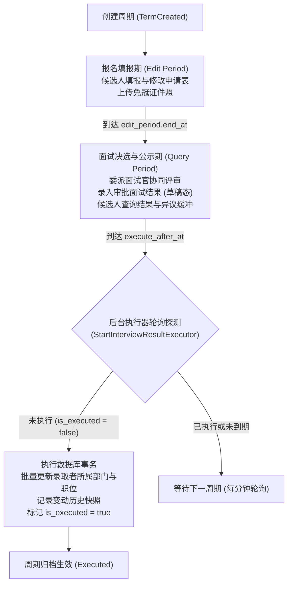
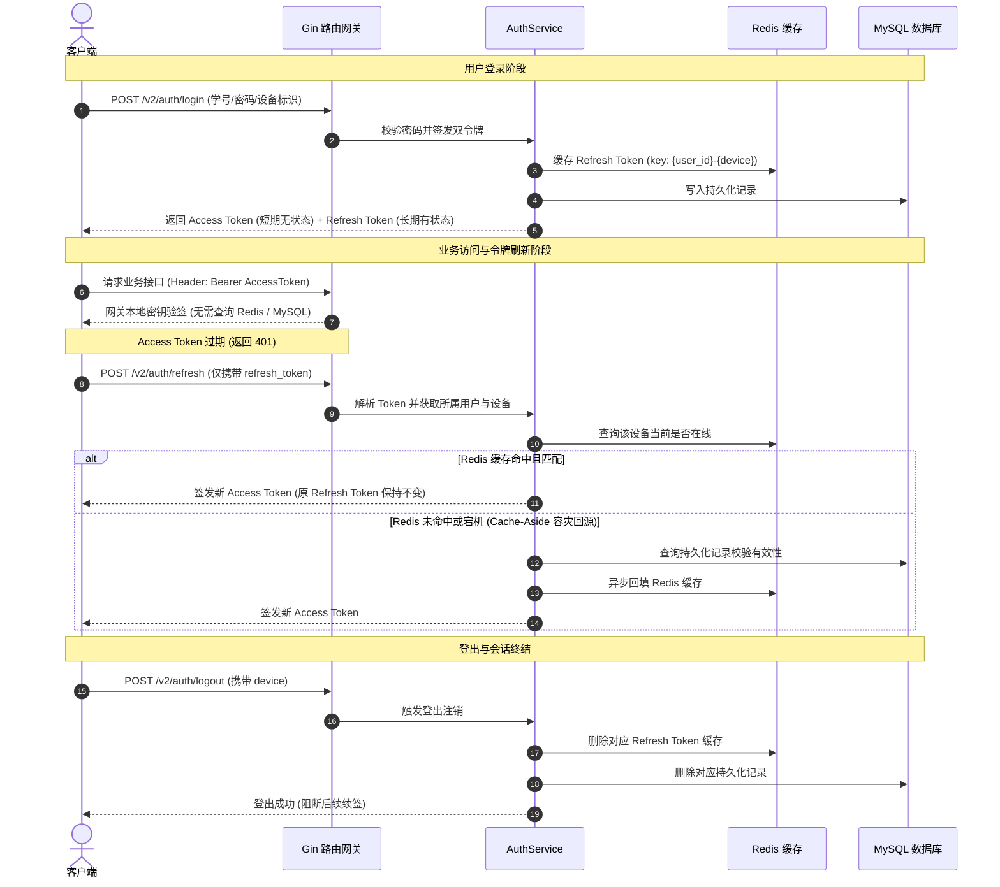

# SUSE OAA Backend

SUSE OAA 后端服务基于 **Go + Gin + GORM + MySQL + Redis + MinIO** 构建，是四川轻化工大学（SUSE）开放原子开源协会（OpenAtom Association, OAA）自研的组织资产与协同管理中台，负责全生命周期成员管理、分级组织架构、公告分发以及招新 / 换届自动化流转。

---

## 目录

- [项目背景与业务定位](#项目背景与业务定位)
- [核心业务流转与时序模型](#核心业务流转与时序模型)
  - [1. 招新与换届生命周期状态流转图](#1-招新与换届生命周期状态流转图)
  - [2. Access + Refresh 双 Token 认证与刷新时序图](#2-access--refresh-双-token-认证与刷新时序图)
- [核心架构设计](#核心架构设计)
- [性能实测与容量表现](#性能实测与容量表现)
  - [1. 实体服务器端到端 HTTP 压力测试（wrk 实测）](#1-实体服务器端到端-http-压力测试wrk-实测)
  - [2. 核心鉴权微基准测试（Go Benchmark）](#2-核心鉴权微基准测试go-benchmark)
- [统一响应与错误分类规范](#统一响应与错误分类规范)
- [接口一览与详细文档](#接口一览与详细文档)
  - [Health（健康检查探针）](#health健康检查探针)
  - [Auth（认证与令牌）](#auth认证与令牌)
  - [Password（密码服务）](#password密码服务)
  - [User（用户管理与注销冷静期）](#user用户管理与注销冷静期)
  - [Department（部门）](#department部门)
  - [Role（职位）](#role职位)
  - [Announcement（公告）](#announcement公告)
  - [Term（招新 / 换届周期）](#term招新--换届周期)
  - [Application（申请表）](#application申请表)
  - [Interviewer（面试官）](#interviewer面试官)
  - [Interview Result（面试结果）](#interview-result面试结果)
  - [Upload（文件与对象存储）](#upload文件与对象存储)
- [关键机制实现细节](#关键机制实现细节)
  - [1. 敏感接口 IP 频次限流（Redis Lua 脚本）](#1-敏感接口-ip-频次限流redis-lua-脚本)
  - [2. 验证码原子防刷与 CAS 释放（SetNX + Lua）](#2-验证码原子防刷与-cas-释放setnx--lua)
  - [3. 账户注销冷静期与级联清理](#3-账户注销冷静期与级联清理)
  - [4. 双后台常驻定时执行器（Daemons）](#4-双后台常驻定时执行器daemons)
  - [5. 全链路 TraceID 注入与 slog 结构化日志](#5-全链路-traceid-注入与-slog-结构化日志)
  - [6. GORM 慢 SQL 结构化告警与日志桥接](#6-gorm-慢-sql-结构化告警与日志桥接)
  - [7. 信号监听与全流程优雅停机（Graceful Shutdown）](#7-信号监听与全流程优雅停机graceful-shutdown)
  - [8. 上传场景安全校验（防路径穿越）](#8-上传场景安全校验防路径穿越)
  - [9. MinIO 双端点隔离与本地离线预签名](#9-minio-双端点隔离与本地离线预签名)
  - [10. 邮件发送安全加固与连接复用](#10-邮件发送安全加固与连接复用)
- [权限与组织架构设计](#权限与组织架构设计)
- [技术栈](#技术栈)
- [配置文件与部署运行](#配置文件与部署运行)
  - [1. 配置文件结构说明](#1-配置文件结构说明)
  - [2. 构建与运行命令（Makefile）](#2-构建与运行命令makefile)
  - [3. CI/CD 流水线与实体机部署](#3-cicd-流水线与实体机部署)

---

## 项目背景与业务定位

### 1. 业务痛点与研发目标
作为高校开源学生组织，协会以往在日常运营中面临以下实际问题：
- **组织数据分散**：花名册分散于电子表格或社群聊天记录，缺乏统一的成员档案、身份凭据与分级权限体系，换届交接成本高；
- **招新期短时并发**：每学年招新周期间，短时间内有较多候选人集中填报、上传证件照、面试官多端打分与录取查询。传统线下或问卷收集方式难以保证状态流转的一致性；
- **录用调整繁琐**：录用通过后，管理员需要逐一调整数十甚至上百名新成员的所属部门与职位，缺乏历史变更记录与自动化流转机制。

### 2. 核心功能覆盖
1. **多端认证与组织架构**：支持学号/邮箱登录、设备会话管理、多级组织树以及基于数字级别（`level`）的 RBAC 权限控制；
2. **公告精准分发**：支持面向全员或特定业务部门下发公告、置顶控制以及 Markdown 内部对象存储直链解析；
3. **招新与换届生命周期管理**：
   - **报名填报期（Edit Period）**：支持申请表并发填写与照片上传；
   - **评审决选期（Query Period）**：委派面试官协同评审、录入面试结果草稿与候选人公示查询；
   - **到期自动生效（Execute Period）**：后台定时任务到达指定截止时间后，在数据库事务中批量将结果写入正式用户表，自动变更部门与职位。

---

## 核心业务流转与时序模型

### 1. 招新与换届生命周期状态流转图



### 2. Access + Refresh 双 Token 认证与刷新时序图



---

## 核心架构设计

- **分层整洁架构**：遵循 `Handler -> Service -> Repository` 分层标准，业务逻辑集中在 Service 层，数据持久化由 Repository 负责，层级边界清晰，便于单元测试编写。
- **无状态双令牌模型**：短期 Access Token 采用 HS256 JWT，由网关本地完成签名解密与 Claims 解析，读接口无需网络 I/O；长期 Refresh Token 采用 Cache-Aside 架构存储于 Redis 与 MySQL 中，实现单设备互踢与即时注销控制。
- **恒定时间比对与防暴力枚举**：验证码校验使用 `crypto/subtle.ConstantTimeCompare` 消除时序侧信道差异；单次验证码连续输错达到 5 次即在 Redis 中销毁，配合 IP 频次限流（5次/分），阻断暴力试错。
- **防刷冷却与原子释放**：发送验证码前通过 Redis `SetNX` 写入独占的随机 Token 占位；若发信失败，通过 Lua 脚本原子比较 Token 一致性后执行删除（CAS），避免误删并发请求的后续冷却标记。
- **输入安全与路径校验**：上传接口对 `scene`（业务场景）执行 `^[a-zA-Z0-9_-]+$` 字符规则校验（1-64字符），禁止包含 `.`、`/`、`\` 等字符，杜绝对象存储目录穿越风险。
- **可观测性闭环**：全局中间件自动注入 `TraceID`；HTTP 层采用自研 `slog` 结构化 `AccessLog`；数据层自研 `GormSlogLogger` 桥接慢 SQL（默认阈值 200ms）及数据库异常，全链路透传同一个 `TraceID`。
- **双健康检查探针**：提供 `/livez`（存活探针，零依赖探测进程）与 `/healthz`（就绪探针，并发 Ping MySQL 连接池与 Redis 并设定 2 秒硬超时），适配负载均衡与容器探针调度。
- **信号监听与优雅停机**：捕获 `SIGINT`/`SIGTERM` 信号，依次等待当前 HTTP 活跃请求处理完毕（5秒超时保护）、通知常驻后台协程退出并等待其完成、安全关闭 MySQL 连接池与 Redis 客户端。

---

## 性能实测与容量表现

所有性能数据均在实验室真实服务器物理硬件环境下采集。

### 1. 实体服务器端到端 HTTP 压力测试（wrk 实测）

- **测试环境**：
  - **服务器硬件**：Intel Xeon E5-2696 v3（18核 36线程，主频 2.30GHz，睿频 3.60GHz），16GB DDR3 内存
  - **操作系统**：Debian GNU/Linux x86_64
  - **运行模式**：Go 1.27.3 单二进制静态编译文件直接运行（无多余运行时与解释器开销）
  - **压测工具**：`wrk`（4 线程、100 并发连接、持续 10 秒）

```text
分层压测结果对比表：
+-----------------------+---------------------+-------------------+------------+-----------+-----------+---------+
| 测试场景              | 请求接口            | 链路所经环节      | QPS (req/s)| P50 延迟  | P99 延迟  | 错误数  |
+-----------------------+---------------------+-------------------+------------+-----------+-----------+---------+
| 1. 框架性能基线       | GET /livez          | 路由+Trace+日志   | 108,989    | 1.12 ms   | 4.16 ms   | 0       |
| 2. 存储健康双探测     | GET /healthz        | 框架+MySQL+Redis  |  85,693    | 1.29 ms   | 4.20 ms   | 0       |
| 3. 真实业务查询(带库) | GET /v2/user/me     | 鉴权+GORM查库+JSON|  18,602    | 4.96 ms   | 12.54 ms  | 0       |
+-----------------------+---------------------+-------------------+------------+-----------+-----------+---------+
```

#### 真实业务接口压测原始数据（`GET /v2/user/me` 携带有效 JWT）：
```text
Running 10s test @ http://127.0.0.1:8080/v2/user/me
  4 threads and 100 connections
  Thread Stats   Avg      Stdev     Max   +/- Stdev
    Latency     5.41ms    2.50ms  61.61ms   76.48%
    Req/Sec     4.69k   159.01     5.19k    74.50%
  Latency Distribution
     50%    4.96ms
     75%    6.59ms
     90%    8.45ms
     99%   12.54ms
  186644 requests in 10.03s, 147.92MB read
Requests/sec:  18602.75
Transfer/sec:     14.74MB
```

- **数据分析**：
  - 核心查询接口在完成完整鉴权与数据库主键查询的情况下，单节点达到 **18,602 QPS**；
  - 响应时间中位数（P50）为 **4.96ms**，99% 的请求在 **12.54ms** 内完成响应；
  - 10 秒内累计处理 186,644 次完整业务请求，**错误率为 0**，连接池与调度表现稳定。

---

### 2. 核心鉴权微基准测试（Go Benchmark）

在代码库中实现标准基准测试套件（[`pkg/utils/jwt_bench_test.go`](pkg/utils/jwt_bench_test.go)），排除 I/O 干扰，单纯衡量 JWT 签名与验签在内存中的 CPU 算力与堆内存逃逸情况：

```bash
go test -bench=. -benchmem -v ./pkg/utils
```

```text
BenchmarkGenerateToken-10          	  818083	      1439 ns/op	    2706 B/op	      37 allocs/op
BenchmarkParseToken-10             	  633609	      1885 ns/op	    2298 B/op	      40 allocs/op
BenchmarkParseToken_Parallel-10    	 1260330	       967.2 ns/op	    2314 B/op	      40 allocs/op
```

- **单核验签耗时**：单次解析与合法性校验耗时约 **1.88 微秒**（纯 CPU 哈希运算，比网络查询 Redis 快数百倍）；
- **内存分配开销**：单次验签仅触发约 40 次小对象堆分配（约 2.3KB），高频调用下对垃圾回收（GC）造成的停顿开销很小；
- **并发扩展性**：在 `BenchmarkParseToken_Parallel` 多协程测试中，并发验签单次耗时降至 **967 纳秒**，验证了无状态计算在多核并行下的无锁线性扩展特性。

---

## 统一响应与错误分类规范

所有 HTTP 接口的响应格式统一遵循以下结构，HTTP 状态码与业务 `code` 严格对齐：

```json
{
  "code": 200,
  "message": "success",
  "data": null
}
```

### 状态码与分类定义

| HTTP 状态码 | 业务方法 | 适用场景 | 前端处理建议 |
| :--- | :--- | :--- | :--- |
| **`200 OK`** | `response.Success(c, data)` | 业务正常执行、健康探针正常 | 正常消费 `data` 并渲染页面 |
| **`400 Bad Request`** | `response.BadRequest(c, msg)` | 参数校验失败、账号密码错误、不在周期内、场景不合法 | 提示用户对应错误文案 |
| **`401 Unauthorized`** | `response.Unauthorized(c, msg)` | 未携带 Token、Token 已过期或被篡改 | 清除本地 Token 并跳转至登录页 |
| **`403 Forbidden`** | `response.Forbidden(c, msg)` | 凭据有效但当前职位等级不足以操作目标资源 | 提示“权限不足” |
| **`404 Not Found`** | `response.NotFound(c, msg)` | 查询的目标资源不存在（如不存在的公告详情） | 提示“资源不存在”并返回列表页 |
| **`429 Too Many Requests`** | `response.TooManyRequests(c)` | 触发 IP 频次限制（登录/发信超频） | 提示“请求过于频繁，请稍后再试” |
| **`500 Internal Error`** | `response.ServerError(c, action, err)` | 未预期系统异常（数据库报错、网络故障等） | 统一脱敏提示：“服务开小差了，请稍后再试” |
| **`503 Service Unavailable`** | `c.JSON(503, ...)` | 服务暂时不可用（`/healthz` 探测到依赖断连） | 负载均衡将该实例移出健康列表 |

---

## 接口一览与详细文档

业务接口统一前缀为 `/v2`。健康探针位于根路径及 `/v2` 路径下（`/livez`、`/healthz`）。

除探针、登录、注册、刷新 Token、发送验证码、重置密码外，**其余业务接口均需在 Header 中携带 Bearer Token**：

```http
Authorization: Bearer <token>
```

---

### Health（健康检查探针）

| 方法 | 路径 | 鉴权 | 说明 | 频控 | 响应数据说明 |
|---|---|---|---|---|---|
| GET | `/livez`、`/v2/livez` | 公开 | 存活探针（Liveness Probe） | 无 | 进程存活返回 200，`data: null` |
| GET | `/healthz`、`/v2/healthz` | 公开 | 就绪探针（Readiness Probe） | 无 | 并发探测 MySQL 与 Redis；均正常返回 200，任一故障返回 503 并在 `data` 指出故障组件 |

---

### Auth（认证与令牌）

| 方法 | 路径 | 鉴权 | 说明 | 频控限制 | 请求参数 |
|---|---|---|---|---|---|
| POST | `/v2/auth/register` | 公开 | 用户注册 | 无 | JSON：`student_id`、`username`、`name`、`email`、`password` |
| POST | `/v2/auth/login` | 公开 | 用户登录 | **10次/分 (IP)** | JSON：`account`（支持学号/用户名/邮箱）、`password`、`device` |
| POST | `/v2/auth/refresh` | 公开 | 刷新令牌 | 无 | JSON：`refresh_token` |
| POST | `/v2/auth/send` | 公开 | 发送邮箱验证码 | **5次/分 (IP)** | JSON：`account`、`scene`（场景名） |
| POST | `/v2/auth/logout` | 登录 | 当前设备登出 | 无 | JSON：`device` |

#### `POST /v2/auth/send` 场景值（`scene`）：
1. `reset_password`：找回/重置密码；
2. `delete_user`：账号注销（若已在冷静期内则返回 400 拦截）；
3. `cancel_delete`：撤销注销冷静期（若未在冷静期内则返回 400 拦截）。

---

### Password（密码服务）

| 方法 | 路径 | 鉴权 | 说明 | 频控限制 | 请求参数 |
|---|---|---|---|---|---|
| POST | `/v2/auth/password/update` | 登录 | 登录态修改密码 | 无 | JSON：`old_password`、`new_password` |
| POST | `/v2/auth/password/reset` | 公开 | 验证码重置密码（恒定时间比对，5次错误熔断） | **5次/分 (IP)** | JSON：`account`、`code`、`password` |

---

### User（用户管理与注销冷静期）

| 方法 | 路径 | 鉴权 | 说明 | 请求参数 |
|---|---|---|---|---|
| GET | `/v2/user/me` | 登录 | 获取当前登录用户资料 | 无 |
| GET | `/v2/user/list` | 登录 | 分页筛选用户列表 | Query：`keyword`、`department_id`、`role_id`、`page`、`page_size`、`is_all` |
| POST | `/v2/user/me/update` | 登录 | 修改用户基础资料 | JSON：`username`、`email`、`avatar` |
| POST | `/v2/user/batch` | 登录 | 批量调整成员部门与职位 | JSON 数组：项包含 `user_id`、`department_id`、`role_id` |
| POST | `/v2/user/delete` | 登录 | 管理员删除 / 注销自己 / 查询冷静期 | JSON：`user_id`、`code`（二者严格互斥） |
| POST | `/v2/user/delete/cancel` | 登录 | 撤销本人注销冷静期 | JSON：`code`（验证码） |

> **用户信息响应结构（`GET /v2/user/me` / `/v2/user/list`）：**
> ```json
> {
>   "code": 200,
>   "message": "success",
>   "data": {
>     "user_id": 42,
>     "student_id": "24101010330",
>     "username": "zhong_yan",
>     "name": "钟研",
>     "email": "user@example.com",
>     "department": "技术部",
>     "role": "部长",
>     "role_level": 80,
>     "avatar": { "uri": "avatar/202610.png", "url": "http://127.0.0.1:9000/..." },
>     "is_deleting": true,
>     "scheduled_delete_at": "2026-10-26 15:04:05"
>   }
> }
> ```
> *注：时间格式与注销接口统一为 `2006-01-02 15:04:05`（东八区）。若账号未在注销冷静期中，`is_deleting` 为 `false` 且 `scheduled_delete_at` 不输出。*

---

### Department（部门）

| 方法 | 路径 | 鉴权 | 说明 | 请求参数 |
|---|---|---|---|---|
| GET | `/v2/department/list` | 登录 | 获取全部部门列表 | 无 |
| POST | `/v2/department/create` | 登录 | 创建部门（需 `level >= 80`） | JSON：`name`、`type`（`部门` / `协会` / `理事会`） |
| POST | `/v2/department/update` | 登录 | 更新部门（需 `level >= 80`） | JSON：`department_id`、`name`、`type`、`is_active` |

---

### Role（职位）

| 方法 | 路径 | 鉴权 | 说明 | 请求参数 |
|---|---|---|---|---|
| GET | `/v2/role/list` | 登录 | 获取全部职位列表 | 无 |
| POST | `/v2/role/create` | 登录 | 创建职位（需 `level >= 80`） | JSON：`name`、`level`、`type`（`部门` / `协会` / `理事会`） |
| POST | `/v2/role/update` | 登录 | 更新职位（需 `level >= 80`） | JSON：`role_id`、`name`、`level`、`type`、`is_active` |

---

### Announcement（公告）

| 方法 | 路径 | 鉴权 | 说明 | 请求参数 |
|---|---|---|---|---|
| POST | `/v2/announcement/create` | 登录 | 创建公告草稿 | JSON：`department_id`、`title`、`content` |
| POST | `/v2/announcement/update` | 登录 | 编辑公告内容 | JSON：`announcement_id`、`title`、`content` |
| POST | `/v2/announcement/push` | 登录 | 发布推送公告 | JSON：`announcement_id` |
| GET | `/v2/announcement/list` | 登录 | 获取公告列表 | Query：`status`、`content`（是否返回正文） |
| GET | `/v2/announcement/get` | 登录 | 获取公告详情（未找到返回 404） | Query：`announcement_id` |
| POST | `/v2/announcement/delete` | 登录 | 删除指定公告 | JSON：`announcement_id` |

---

### Term（招新 / 换届周期）

| 方法 | 路径 | 鉴权 | 说明 | 请求参数 |
|---|---|---|---|---|
| POST | `/v2/term/create` | 登录 | 创建周期（`level >= 80`） | JSON：`year`、`type`、`title`、`edit_period`、`query_period` |
| POST | `/v2/term/update` | 登录 | 更新周期（`level >= 80`） | JSON：`term_id`、`title`、`edit_period`、`query_period` |
| GET | `/v2/term/list` | 登录 | 查询周期列表 | Query：`year`、`type` |
| POST | `/v2/term/delete` | 登录 | 删除周期（未执行方可删除） | JSON：`term_id` |

---

### Application（申请表）

| 方法 | 路径 | 鉴权 | 说明 | 请求参数 |
|---|---|---|---|---|
| POST | `/v2/application/create` | 登录 | 提交周期申请表 | JSON：申请表各字段 |
| POST | `/v2/application/update` | 登录 | 修改本人最新申请表 | JSON：申请表各字段（仅限在 edit_period 内） |
| GET | `/v2/application/me` | 登录 | 查看本人最新申请表 | 无 |
| GET | `/v2/application/department` | 登录 | 联动查询可选部门 | Query：`role_id`（可选） |
| GET | `/v2/application/role` | 登录 | 联动查询可选职位 | Query：`department_id`（可选） |
| GET | `/v2/application/list` | 登录 | 查询指定周期申请表 | Query：`term_id`（必填）、`department_id`（可选） |
| POST | `/v2/application/delete` | 登录 | 删除申请表 | JSON：`application_id` |

---

### Interviewer（面试官）

| 方法 | 路径 | 鉴权 | 说明 | 请求参数 |
|---|---|---|---|---|
| POST | `/v2/interviewer/create` | 登录 | 委派面试官（`level >= 80`） | JSON：`term_id`、`interviewers`（数组） |
| POST | `/v2/interviewer/update` | 登录 | 更新面试官备注 | JSON：`interviewer_id`、`remark` |
| GET | `/v2/interviewer/list` | 登录 | 查询面试官列表 | Query：`term_id` |
| POST | `/v2/interviewer/delete` | 登录 | 移除面试官 | JSON：`interviewer_id` |

---

### Interview Result（面试结果）

| 方法 | 路径 | 鉴权 | 说明 | 请求参数 |
|---|---|---|---|---|
| POST | `/v2/interviewer/result/create` | 登录 | 录入面试决策结果 | JSON：`application_id`、`decision`、`result_department_id`、`result_role_id`、`remark` |
| POST | `/v2/interviewer/result/update` | 登录 | 更新面试决策结果 | JSON：同上 |
| GET | `/v2/interviewer/result/list` | 登录 | 查询面试结果列表 | Query：`term_id` |
| GET | `/v2/interviewer/result/decision` | 登录 | 获取面试决策枚举 | 无 |

---

### Upload（文件与对象存储）

| 方法 | 路径 | 鉴权 | 说明 | 请求参数 |
|---|---|---|---|---|
| POST | `/v2/upload/image` | 登录 | 上传图片 | `multipart/form-data`：`file`、`scene` |
| POST | `/v2/upload/file` | 登录 | 上传通用文件 | `multipart/form-data`：`file`、`scene` |

- **`scene` 校验规则**：只允许字母、数字、下划线 `_` 和中划线 `-`（1-64 字符），严禁包含 `.`、`/`、`\` 等字符，非法参数直接返回 `400 "上传场景不合法"`。
- **图片类型限制**：仅允许 `.jpg`、`.jpeg`、`.png`、`.webp`、`.gif`、`.avif`。

---

## 关键机制实现细节

### 1. 敏感接口 IP 频次限流（Redis Lua 脚本）
在 [`internal/middleware/rate_limit.go`](internal/middleware/rate_limit.go) 中，通过单次 Redis Lua 脚本执行 `INCR` 与 `EXPIRE` 闭环判断：
- 登录接口：单个 IP 每分钟限制 10 次，防范密码爆破与算力消耗；
- 发送验证码与重置密码接口：单个 IP 每分钟限制 5 次；
- 网关显式配置 `SetTrustedProxies` 白名单，防范伪造代理头绕过限流；
- 若 Redis 发生临时抖动，中间件自动捕获异常降级放行，保障核心业务可用。

### 2. 验证码原子防刷与 CAS 释放（SetNX + Lua）
在 [`internal/repository/user.go`](internal/repository/user.go) 中：
- 调用 `SetCooldownNX` 时，在 Redis 中写入请求独占的高熵随机 UUID 作为冷却标记；
- 若后续发信失败，通过 Lua 脚本原子比较当前 Key 是否为本次请求写入的 UUID，仅在匹配时才执行 `DEL`，杜绝网络延迟超时后误删他人后置冷却标记。

### 3. 账户注销冷静期与级联清理
- 用户通过邮箱验证码发起自主注销后，账号进入 24 小时冷静期（`scheduled_delete_at = NOW() + 24h`），期间账号可正常登录使用；
- 用户信息模型（`UserInfo`）显式返回 `is_deleting` 状态字段与 `scheduled_delete_at` 计划注销时间（格式与注销接口统一为 `2006-01-02 15:04:05`，东八区），前后端统一通过服务端状态判定，避免客户端本地时钟偏差；
- 冷静期内支持查询到期时间，或通过 `cancel_delete` 验证码随时撤回注销；
- 到期由后台任务或管理员强制删除时，触发逻辑软删除并级联清理 MySQL `refresh_tokens` 与 Redis 全端会话凭据。

### 4. 双后台常驻定时执行器（Daemons）
在 `cmd/main.go` 中并行启动两个后台协程（受 `context.Context` 生命周期控制，每分钟调度一次）：
- **`StartUserDeletionExecutor`**：扫描到期账号并批量执行级联软删除与会话清理；
- **`StartInterviewResultExecutor`**：扫描到期招新/换届周期，在事务中批量变更录用者的部门与职位，并标记周期归档。

### 5. 全链路 TraceID 注入与 slog 结构化日志
- 中间件为每个请求分配唯一 `TraceID`（支持校验客户端传入的合规 ID，防范日志注入），并写入响应头 `X-Trace-ID` 与请求 Context；
- 采用 `gin.New()` 并自主实现 `AccessLog` 中间件，请求完成后统一以 JSON 结构输出日志，包含方法、路径、状态码、延时（毫秒）、客户端真实 IP 与 TraceID。

### 6. GORM 慢 SQL 结构化告警与日志桥接
在 [`internal/database/logger.go`](internal/database/logger.go) 中实现 GORM 日志适配器：
- 单条 SQL 执行耗时超过阈值（默认 200ms）时，自动触发 `slog.WarnContext` 记录 `sql`、`rows`、`latency_ms` 与 `slow_threshold`；
- 继承请求 Context 中的 `trace_id`，实现从 HTTP 请求到慢 SQL 的统一日志关联；
- 自动过滤 `gorm.ErrRecordNotFound`，避免日常查空产生干扰告警。

### 7. 信号监听与全流程优雅停机（Graceful Shutdown）
捕获 `SIGINT` 与 `SIGTERM` 操作系统信号后，按严谨顺序退出：
1. 停止接收新 HTTP 请求，给存量请求 5 秒缓冲完成处理；
2. 取消后台 Worker 的 Context，等待正在执行的批量事务收尾；
3. 安全关闭 MySQL 连接池与 Redis 客户端连接。

### 8. 上传场景安全校验（防路径穿越）
在 [`internal/service/file.go`](internal/service/file.go) 中对上传入参 `scene` 统一校验：
- 采用正则表达式 `^[a-zA-Z0-9_-]+$`；
- 拦截包含 `.` 与 `/` 的恶意入参，避免拼接 MinIO 对象路径时产生目录逃逸。

### 9. MinIO 双端点隔离与本地离线预签名
- **双端点**：内部通信使用内网端点，对外使用公网域名；
- **离线预签名**：根据公网端点在服务端本地执行 S3 V4 哈希计算生成直链，无需每次向存储服务发起网络探活，降低读取接口的响应延迟。

### 10. 邮件发送安全加固与连接复用
- 废弃 `InsecureSkipVerify: true`，显式配置 `ServerName: host` 开启完整的 TLS 证书域名校验，防范中间人劫持；
- 服务初始化时复用 Dialer 实例，避免高频请求重复创建连接配置。

---

## 权限与组织架构设计

系统初次启动时会自动初始化基础角色，权限判定依托数值 `level` 动态比对：

| 角色名称 | Level | 适用类型 | 职责描述 |
|:---|:---:|:---|:---|
| 开发者 | 100 | 协会 | 系统超级管理员 |
| 会长 | 90 | 理事会 | 协会最高负责人 |
| 副会长 | 80 | 理事会 | 分管负责人，拥有审批与管理权限 |
| 部长 | 60 | 部门 | 部门负责人 |
| 副部长 | 50 | 部门 | 部门协助负责人 |
| 干事 | 20 | 部门 | 部门事务执行成员 |
| 会员 | 10 | 协会 | 普通会员，注册默认角色 |

---

## 技术栈

| 模块 | 选型 | 说明 |
|---|---|---|
| **语言与运行时** | Go 1.27.3 | 静态编译、强类型、原生并发模型 |
| **Web 路由框架** | Gin (`github.com/gin-gonic/gin`) | 基于 Radix Tree 的轻量高性能路由引擎 |
| **ORM 持久化** | GORM (`gorm.io/gorm` + MySQL 驱动) | 全逻辑外键，自研 slog 结构化慢查询日志桥接 |
| **缓存中间件** | Redis (`github.com/redis/go-redis/v9`) | 会话缓存、Lua 原子限流、SetNX 冷却防刷 |
| **对象存储** | MinIO SDK (`github.com/minio/minio-go/v7`) | 兼容 AWS S3 协议，支持双端点与离线预签名 |
| **结构化日志** | Go 1.21+ `log/slog` | 标准库原生结构化 JSON 日志，全链路透传 TraceID |
| **安全与加固** | JWT (`golang-jwt/jwt/v5`) + Bcrypt + Subtle | 双令牌架构、密码哈希与恒定时间比对 |
| **配置管理** | Viper (`github.com/spf13/viper`) | 支持 YAML 配置文件与 `OAA_` 环境变量动态覆盖 |
| **持续集成部署**| GitHub Actions + Self-Hosted Runner | 自动化单测与针对国内服务器优化的无 Git 镜像极速部署 |

---

## 配置文件与部署运行

### 1. 配置文件结构说明

项目配置模板位于 `configs/config_example.yaml`。首次部署时复制为 `configs/config.yaml`：

```bash
cp configs/config_example.yaml configs/config.yaml
```

系统支持通过环境变量进行动态覆盖（遵循 12-Factor App 规范），规则为：前缀 `OAA_` 并将配置层级用下划线 `_` 连接。例如：
- `OAA_SERVER_PORT="8080"` 覆盖 `server.port`
- `OAA_MYSQL_PASSWORD="xxx"` 覆盖 `mysql.password`
- `OAA_JWT_SECRET="xxx"` 覆盖 `jwt.secret`

核心配置块如下：
- `server`：监听地址（`host`）、端口（`port`）、运行模式（`mode`）、受信任代理列表（`trusted_proxies`）；
- `mysql`：数据库连接信息、最大打开连接（`max_open_conns`）、最大空闲连接（`max_idle_conns`）、超时寿命；
- `redis`：Redis 主机、端口、密码与逻辑数据库编号；
- `jwt`：加密密钥（`secret`）、Token 有效时长；
- `email`：SMTP 主机、端口、发信凭据与冷却时长；
- `minio`：内部通信端点、公网预签名端点、Region、AccessKey/SecretKey 与存储桶名称。

---

### 2. 构建与运行命令（Makefile）

项目包含标准 `Makefile`，支持常见构建与测试工作：

```bash
# 1. 静态语法检测与单元测试（含竞态检测）
make vet
make test

# 2. 本地直接调试运行
make run

# 3. 静态编译为 Linux amd64 生产部署二进制产物（输出至 bin/OAAbeta）
make linux

# 4. 交叉编译为其他架构
make linux GOARCH=arm64
```

---

### 3. CI/CD 流水线与实体机部署

项目在 `.github/workflows/` 中维护了自动化持续集成与发布工作流：

1. **持续集成（CI - `ci.yml`）**：
   - 监听主分支 Push 与 PR；
   - 自动运行 `go vet ./...` 检查与 `go test -v -race ./...` 单元测试，保障主干分支质量。
2. **发布与实体机部署（CD - `release.yml`）**：
   - 推送版本标签（如 `git tag v2.1.3 && git push origin v2.1.3`）时自动触发；
   - 在 Linux 容器中静态交叉编译 amd64 单二进制文件并剔除调试符号瘦身，上传至 GitHub Releases；
   - 实体服务器通过本地 Runner 接收部署任务，**直接通过国内加速镜像源拉取制品包并解压**，绕开国内网络对 GitHub Git 与 Artifact RPC 的连接阻断，平滑替换二进制并向 `tmux` 发送优雅重启信号。
